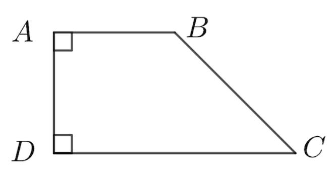
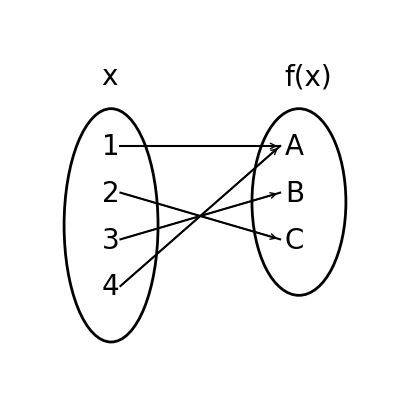

# AVP1684 — Single visual target

DynaMath:62 / DynaMath:90 · different type · Mathematical roles of symbols

## Shared or similar visual information

The uppercase letter A.

## Evidence locations

- Left image: A at the upper-left vertex of the trapezoid.
- Right image: A at the top element in the f(x) oval receiving arrows from 1 and 4.

## Mathematical meanings

Left image: A names a specific point in the diagram (the upper-left vertex of the trapezoid). Right image: A names an element of the output set of the mapping (the top element in the f(x) oval receiving arrows from 1 and 4).

## Same mathematical meanings

no

## Rationales

On the left, A names a specific point in the diagram (the upper-left vertex of the trapezoid). On the right, A names an element of the output set of the mapping (the top element in the f(x) oval receiving arrows from 1 and 4).

Only the selected target is annotated. AI visual-review draft; not independently double-annotated by humans.
