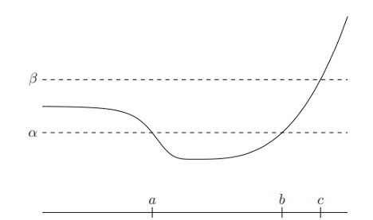
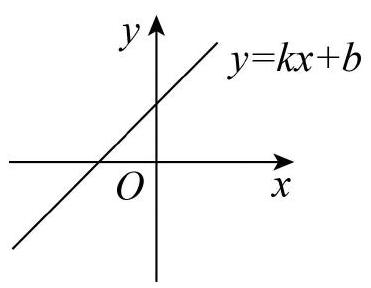

# AVP1685 — Single visual target

MathVista:723 / MV-MATH:950_1 · same type · Mathematical roles of symbols

## Shared or similar visual information

The lowercase letter b.

## Evidence locations

- Left image: b at the label under the middle marked horizontal position.
- Right image: b at the final term in y = kx + b.

## Mathematical meanings

Left image: b denotes a specific value on the horizontal input axis (the label under the middle marked horizontal position). Right image: b gives the additive constant and vertical intercept of the line (the final term in y = kx + b).

## Same mathematical meanings

no

## Rationales

On the left, b denotes a specific value on the horizontal input axis (the label under the middle marked horizontal position). On the right, b gives the additive constant and vertical intercept of the line (the final term in y = kx + b).

Only the selected target is annotated. AI visual-review draft; not independently double-annotated by humans.
