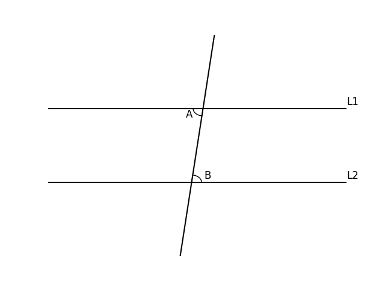
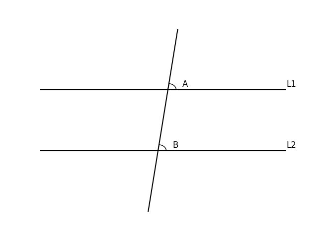

# AVP1686 — Single visual target

DynaMath:181 / DynaMath:184 · same type · Mathematical roles of symbols

## Shared or similar visual information

The uppercase letter A.

## Evidence locations

- Left image: A at the angle arc below the upper horizontal line.
- Right image: A at the angle arc above the upper horizontal line.

## Mathematical meanings

Left image: A identifies the marked angle (the angle arc below the upper horizontal line). Right image: A identifies the marked angle (the angle arc above the upper horizontal line).

## Same mathematical meanings

yes

## Rationales

In both images, A identifies the marked angle. The relevant locations are the angle arc below the upper horizontal line on the left and the angle arc above the upper horizontal line on the right.

Only the selected target is annotated. AI visual-review draft; not independently double-annotated by humans.
