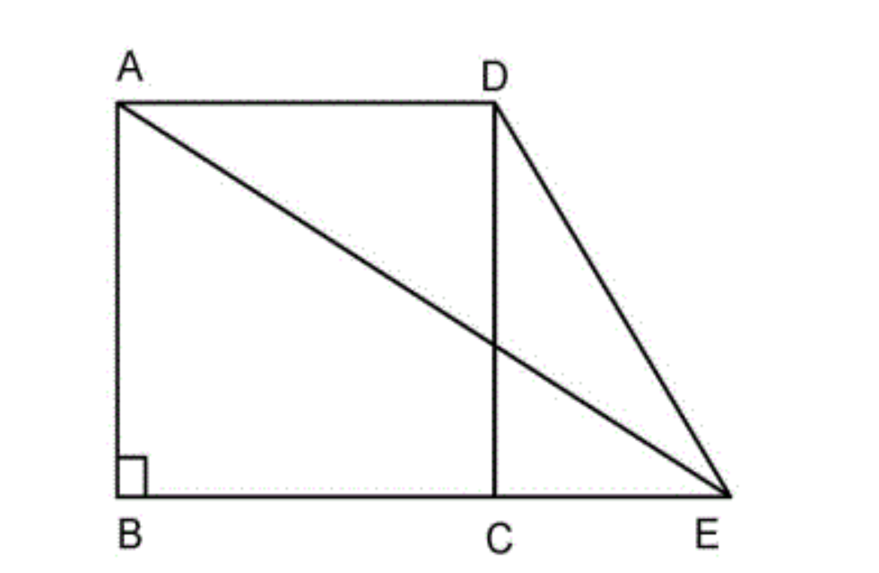
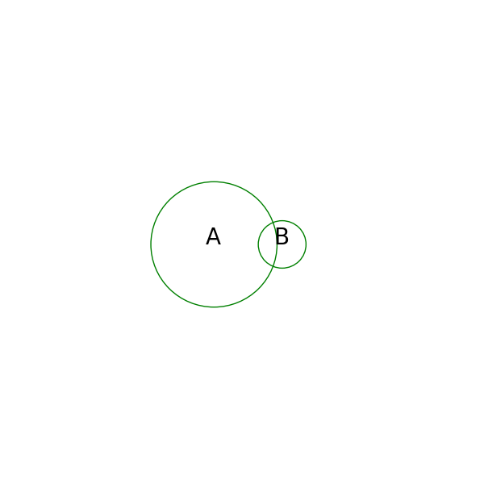

# AVP1689 — Single visual target

DynaMath:281 / DynaMath:121 · different type · Mathematical roles of symbols

## Shared or similar visual information

The uppercase letter A.

## Evidence locations

- Left image: A at the upper-left corner of the rectangle.
- Right image: A at the label inside the larger green circle.

## Mathematical meanings

Left image: A names a specific point in the diagram (the upper-left corner of the rectangle). Right image: A names the set represented by the circle (the label inside the larger green circle).

## Same mathematical meanings

no

## Rationales

On the left, A names a specific point in the diagram (the upper-left corner of the rectangle). On the right, A names the set represented by the circle (the label inside the larger green circle).

Only the selected target is annotated. AI visual-review draft; not independently double-annotated by humans.
