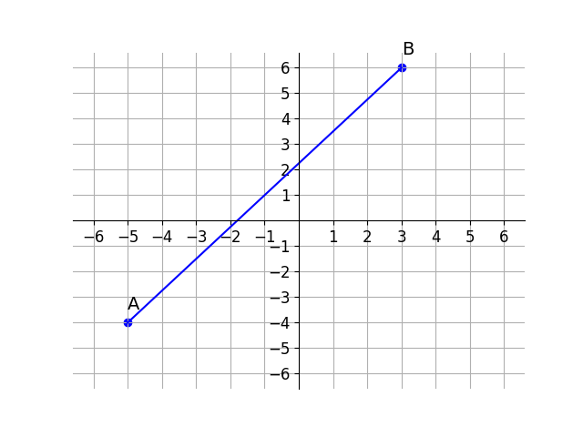
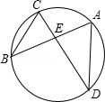

# AVP1692 — Single visual target

DynaMath:135 / MathVista:30 · same type · Mathematical roles of symbols

## Shared or similar visual information

The uppercase letter B.

## Evidence locations

- Left image: B at the upper-right endpoint of the blue segment.
- Right image: B at the left-hand point on the circle.

## Mathematical meanings

Left image: B names a specific point in the diagram (the upper-right endpoint of the blue segment). Right image: B names a specific point in the diagram (the left-hand point on the circle).

## Same mathematical meanings

yes

## Rationales

In both images, B names a specific point in the diagram. The relevant locations are the upper-right endpoint of the blue segment on the left and the left-hand point on the circle on the right.

Only the selected target is annotated. AI visual-review draft; not independently double-annotated by humans.
