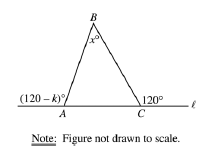
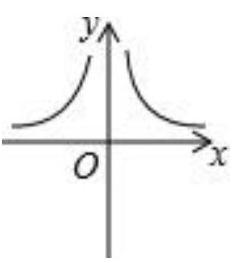

# AVP1693 — Single visual target

MathVista:434 / MV-MATH:996_1 · different type · Mathematical roles of symbols

## Shared or similar visual information

The lowercase letter x.

## Evidence locations

- Left image: x at the x° label inside the top angle at B.
- Right image: x at the right arrow of the horizontal axis beside the two branches.

## Mathematical meanings

Left image: x gives an unknown angle measure (the x° label inside the top angle at B). Right image: x names the horizontal coordinate axis (the right arrow of the horizontal axis beside the two branches).

## Same mathematical meanings

no

## Rationales

On the left, x represents an unknown angle measure (the x° label inside the top angle at B). On the right, x names the horizontal coordinate axis (the right arrow of the horizontal axis beside the two branches).

Only the selected target is annotated. AI visual-review draft; not independently double-annotated by humans.
