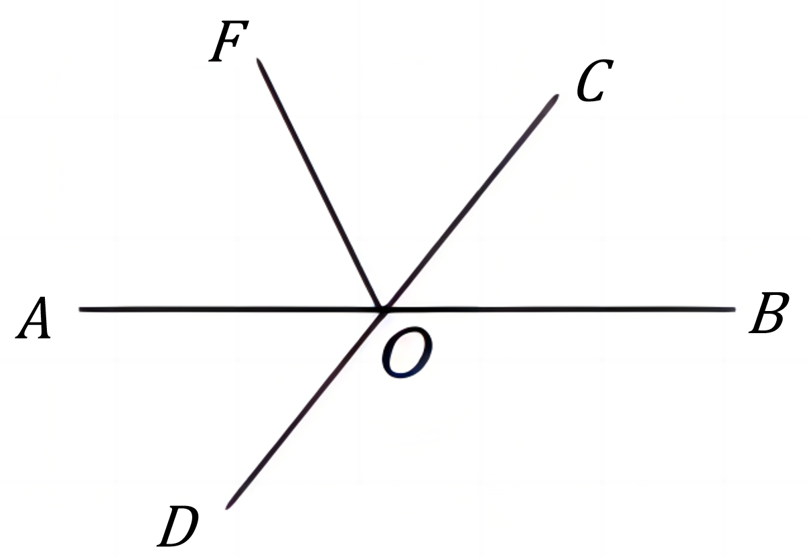
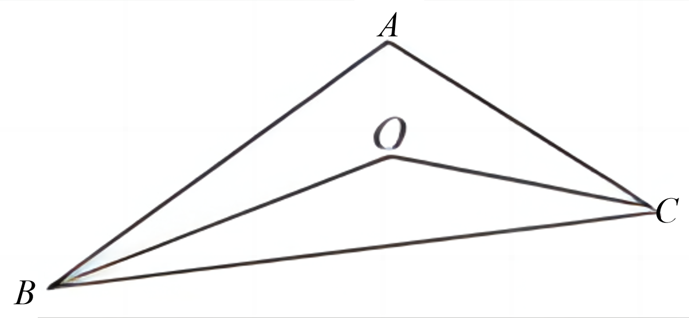

# AVP1695 — Single visual target

DynaMath:11 / DynaMath:93 · same type · Mathematical roles of symbols

## Shared or similar visual information

The uppercase letter O.

## Evidence locations

- Left image: O at the common intersection of the horizontal and sloping lines.
- Right image: O at the interior vertex of the broken line from B to C.

## Mathematical meanings

Left image: O names a specific point in the diagram (the common intersection of the horizontal and sloping lines). Right image: O names a specific point in the diagram (the interior vertex of the broken line from B to C).

## Same mathematical meanings

yes

## Rationales

In both images, O names a specific point in the diagram. The relevant locations are the common intersection of the horizontal and sloping lines on the left and the interior vertex of the broken line from B to C on the right.

Only the selected target is annotated. AI visual-review draft; not independently double-annotated by humans.
