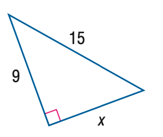
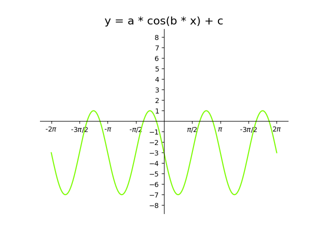

# AVP1706 — Single visual target

MathVista:160 / DynaMath:346 · different type · Mathematical roles of symbols

## Shared or similar visual information

The lowercase letter x.

## Evidence locations

- Left image: x at the label beside the lower leg of the right triangle.
- Right image: x at the input multiplied by b inside cos(b * x).

## Mathematical meanings

Left image: x gives an unknown length (the label beside the lower leg of the right triangle). Right image: x is the independent input variable in the trigonometric expression (the input multiplied by b inside cos(b * x)).

## Same mathematical meanings

no

## Rationales

On the left, x represents an unknown length (the label beside the lower leg of the right triangle). On the right, x is the independent input variable in the trigonometric expression (the input multiplied by b inside cos(b * x)).

Only the selected target is annotated. AI visual-review draft; not independently double-annotated by humans.
