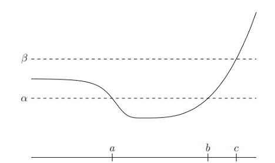
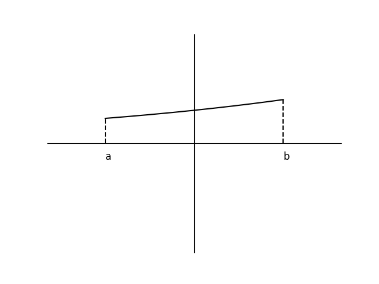

# AVP1711 — Single visual target

MathVista:723 / DynaMath:203 · same type · Mathematical roles of symbols

## Shared or similar visual information

The lowercase letter a.

## Evidence locations

- Left image: a at the label under the first marked position on the horizontal axis.
- Right image: a at the label beneath the left dashed projection.

## Mathematical meanings

Left image: a denotes a specific value on the horizontal input axis (the label under the first marked position on the horizontal axis). Right image: a denotes a specific value on the horizontal input axis (the label beneath the left dashed projection).

## Same mathematical meanings

yes

## Rationales

In both images, a denotes a specific value on the horizontal input axis. The relevant locations are the label under the first marked position on the horizontal axis on the left and the label beneath the left dashed projection on the right.

Only the selected target is annotated. AI visual-review draft; not independently double-annotated by humans.
