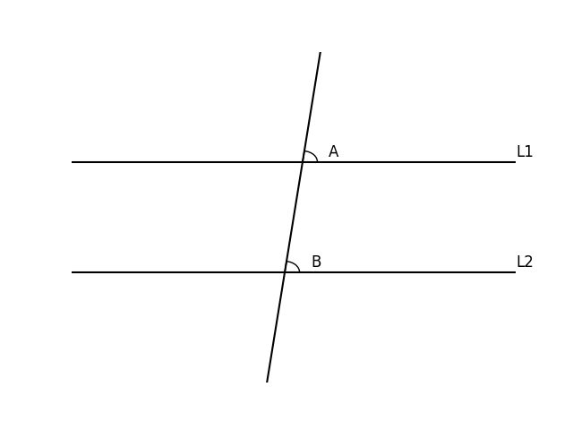
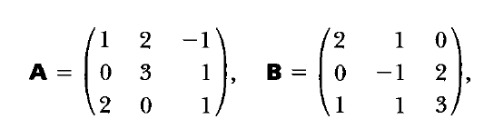

# AVP1712 — Single visual target

DynaMath:184 / MathVista:577 · different type · Mathematical roles of symbols

## Shared or similar visual information

The uppercase letter A.

## Evidence locations

- Left image: A at the angle arc above the upper horizontal line.
- Right image: A at the label before the first parenthesized matrix.

## Mathematical meanings

Left image: A identifies the marked angle (the angle arc above the upper horizontal line). Right image: A names the matrix printed after the equals sign (the label before the first parenthesized matrix).

## Same mathematical meanings

no

## Rationales

On the left, A identifies the marked angle (the angle arc above the upper horizontal line). On the right, A names the matrix printed after the equals sign (the label before the first parenthesized matrix).

Only the selected target is annotated. AI visual-review draft; not independently double-annotated by humans.
