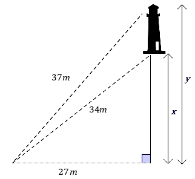
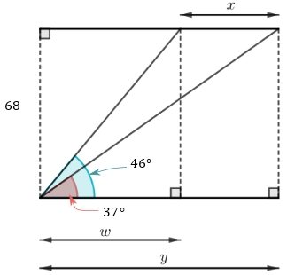

# AVP1715 — Single visual target

MathVerse:366 / MathVerse:358 · same type · Mathematical roles of symbols

## Shared or similar visual information

The lowercase letter y.

## Evidence locations

- Left image: y at the label beside the longest vertical dimension arrow at the lighthouse.
- Right image: y at the label on the bottom arrow spanning the full width.

## Mathematical meanings

Left image: y gives an unknown length (the label beside the longest vertical dimension arrow at the lighthouse). Right image: y gives an unknown length (the label on the bottom arrow spanning the full width).

## Same mathematical meanings

yes

## Rationales

In both images, y represents an unknown length. The relevant locations are the label beside the longest vertical dimension arrow at the lighthouse on the left and the label on the bottom arrow spanning the full width on the right.

Only the selected target is annotated. AI visual-review draft; not independently double-annotated by humans.
