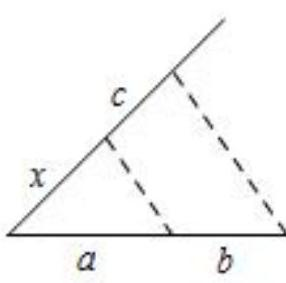
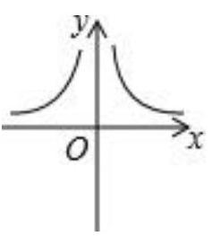

# AVP1718 — Single visual target

MV-MATH:505_1 / MV-MATH:996_1 · different type · Mathematical roles of symbols

## Shared or similar visual information

The lowercase letter x.

## Evidence locations

- Left image: x at the lower segment of the rising slanted side.
- Right image: x at the right arrow of the horizontal axis beside the two branches.

## Mathematical meanings

Left image: x gives an unknown length (the lower segment of the rising slanted side). Right image: x names the horizontal coordinate axis (the right arrow of the horizontal axis beside the two branches).

## Same mathematical meanings

no

## Rationales

On the left, x represents an unknown length (the lower segment of the rising slanted side). On the right, x names the horizontal coordinate axis (the right arrow of the horizontal axis beside the two branches).

Only the selected target is annotated. AI visual-review draft; not independently double-annotated by humans.
