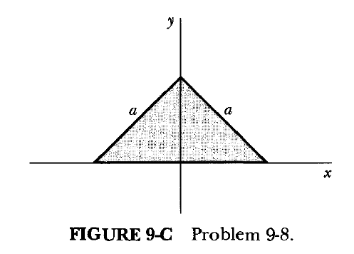
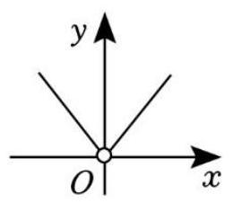

# AVP1726 — Single visual target

MathVista:512 / MV-MATH:610_1 · different type · Mathematical roles of symbols

## Shared or similar visual information

The lowercase letter y.

## Evidence locations

- Left image: y at the top of the axis through the triangular region.
- Right image: y at the top arrow on the vertical axis through the open circle.

## Mathematical meanings

Left image: y names the vertical coordinate axis (the top of the axis through the triangular region). Right image: y names the vertical coordinate axis (the top arrow on the vertical axis through the open circle).

## Same mathematical meanings

yes

## Rationales

In both images, y names the vertical coordinate axis. The relevant locations are the top of the axis through the triangular region on the left and the top arrow on the vertical axis through the open circle on the right.

Only the selected target is annotated. AI visual-review draft; not independently double-annotated by humans.
