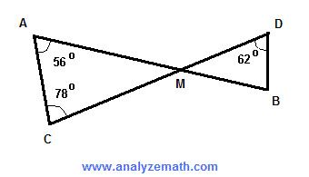
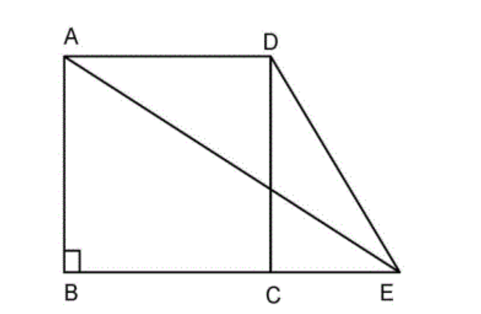

# AVP1734 — Single visual target

MathVista:630 / DynaMath:281 · same type · Mathematical roles of symbols

## Shared or similar visual information

The uppercase letter A.

## Evidence locations

- Left image: A at the upper-left vertex of the crossing triangles.
- Right image: A at the upper-left corner of the rectangle.

## Mathematical meanings

Left image: A names a specific point in the diagram (the upper-left vertex of the crossing triangles). Right image: A names a specific point in the diagram (the upper-left corner of the rectangle).

## Same mathematical meanings

yes

## Rationales

In both images, A names a specific point in the diagram. The relevant locations are the upper-left vertex of the crossing triangles on the left and the upper-left corner of the rectangle on the right.

Only the selected target is annotated. AI visual-review draft; not independently double-annotated by humans.
