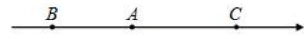
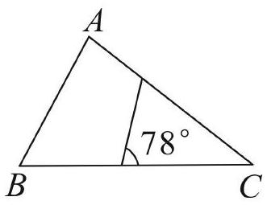

# AVP1741 — Single visual target

MV-MATH:448_1 / MV-MATH:526_1 · same type · Mathematical roles of symbols

## Shared or similar visual information

The uppercase letter A.

## Evidence locations

- Left image: A at the middle black point on the horizontal ray.
- Right image: A at the upper vertex of the triangle with the 78° interior construction.

## Mathematical meanings

Left image: A names a specific point in the diagram (the middle black point on the horizontal ray). Right image: A names a specific point in the diagram (the upper vertex of the triangle with the 78° interior construction).

## Same mathematical meanings

yes

## Rationales

In both images, A names a specific point in the diagram. The relevant locations are the middle black point on the horizontal ray on the left and the upper vertex of the triangle with the 78° interior construction on the right.

Only the selected target is annotated. AI visual-review draft; not independently double-annotated by humans.
