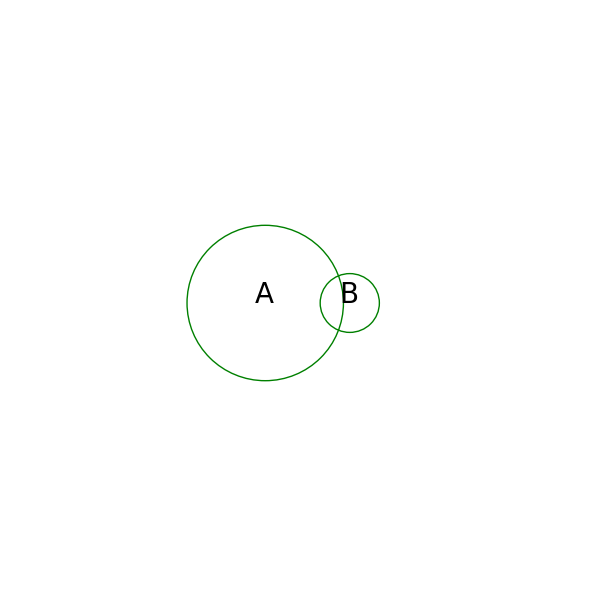
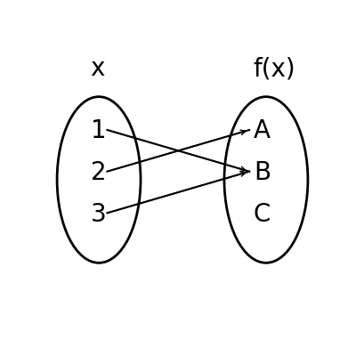

# AVP1746 — Single visual target

DynaMath:121 / DynaMath:89 · different type · Mathematical roles of symbols

## Shared or similar visual information

The uppercase letter A.

## Evidence locations

- Left image: A at the label inside the larger green circle.
- Right image: A at the top element in the f(x) oval receiving an arrow from 2.

## Mathematical meanings

Left image: A names the set represented by the circle (the label inside the larger green circle). Right image: A names an element of the output set of the mapping (the top element in the f(x) oval receiving an arrow from 2).

## Same mathematical meanings

no

## Rationales

On the left, A names the set represented by the circle (the label inside the larger green circle). On the right, A names an element of the output set of the mapping (the top element in the f(x) oval receiving an arrow from 2).

Only the selected target is annotated. AI visual-review draft; not independently double-annotated by humans.
