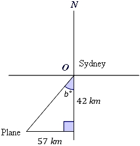
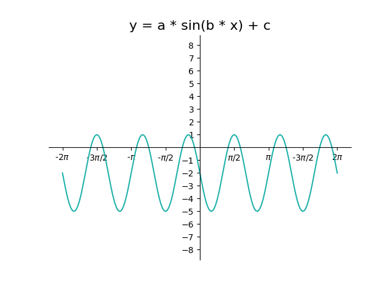

# AVP1749 — Single visual target

MathVerse:344 / DynaMath:345 · different type · Mathematical roles of symbols

## Shared or similar visual information

The lowercase letter b.

## Evidence locations

- Left image: b at the b° label at O beside the dashed flight segment.
- Right image: b at the factor multiplying x inside the sine argument.

## Mathematical meanings

Left image: b gives an unknown angle measure (the b° label at O beside the dashed flight segment). Right image: b scales the input of the trigonometric function and controls the period (the factor multiplying x inside the sine argument).

## Same mathematical meanings

no

## Rationales

On the left, b represents an unknown angle measure (the b° label at O beside the dashed flight segment). On the right, b scales the input of the trigonometric function and controls the period (the factor multiplying x inside the sine argument).

Only the selected target is annotated. AI visual-review draft; not independently double-annotated by humans.
