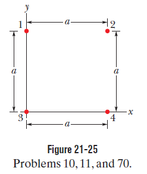
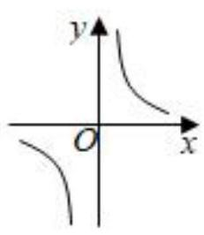

# AVP1750 — Single visual target

MathVista:294 / MV-MATH:1080_1 · different type · Mathematical roles of symbols

## Shared or similar visual information

The lowercase letter y.

## Evidence locations

- Left image: y at the upper end of the vertical axis passing through points 1 and 3.
- Right image: y at the upper arrow between the two function branches.

## Mathematical meanings

Left image: y names the vertical coordinate axis (the upper end of the vertical axis passing through points 1 and 3). Right image: y names the vertical coordinate axis (the upper arrow between the two function branches).

## Same mathematical meanings

yes

## Rationales

In both images, y names the vertical coordinate axis. The relevant locations are the upper end of the vertical axis passing through points 1 and 3 on the left and the upper arrow between the two function branches on the right.

Only the selected target is annotated. AI visual-review draft; not independently double-annotated by humans.
