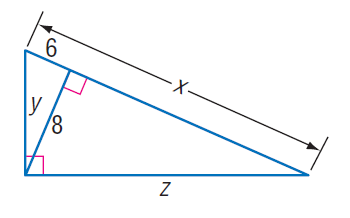
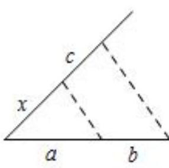

# AVP1756 — Single visual target

MathVista:310 / MV-MATH:505_1 · same type · Mathematical roles of symbols

## Shared or similar visual information

The lowercase letter x.

## Evidence locations

- Left image: x at the label on the dimension arrow spanning the slanted side.
- Right image: x at the lower segment of the rising slanted side.

## Mathematical meanings

Left image: x gives an unknown length (the label on the dimension arrow spanning the slanted side). Right image: x gives an unknown length (the lower segment of the rising slanted side).

## Same mathematical meanings

yes

## Rationales

In both images, x represents an unknown length. The relevant locations are the label on the dimension arrow spanning the slanted side on the left and the lower segment of the rising slanted side on the right.

Only the selected target is annotated. AI visual-review draft; not independently double-annotated by humans.
