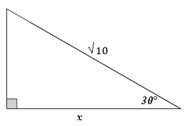
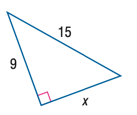

# AVP1759 — Single visual target

MathVerse:374 / MathVista:160 · same type · Mathematical roles of symbols

## Shared or similar visual information

The lowercase letter x.

## Evidence locations

- Left image: x at the label below the right triangle’s base.
- Right image: x at the label beside the lower leg of the right triangle.

## Mathematical meanings

Left image: x gives an unknown length (the label below the right triangle’s base). Right image: x gives an unknown length (the label beside the lower leg of the right triangle).

## Same mathematical meanings

yes

## Rationales

In both images, x represents an unknown length. The relevant locations are the label below the right triangle’s base on the left and the label beside the lower leg of the right triangle on the right.

Only the selected target is annotated. AI visual-review draft; not independently double-annotated by humans.
