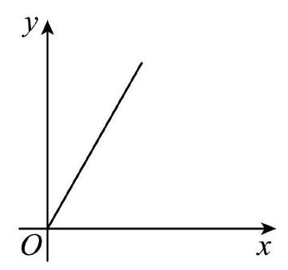
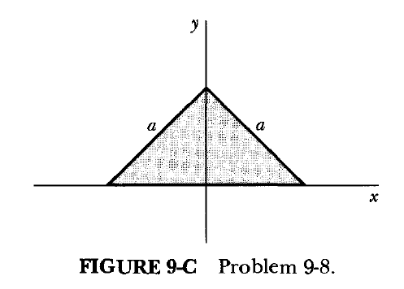

# AVP1763 — Single visual target

MV-MATH:1047_1 / MathVista:512 · different type · Mathematical roles of symbols

## Shared or similar visual information

The lowercase letter y.

## Evidence locations

- Left image: y at the upper arrowhead of the vertical axis beside the ray.
- Right image: y at the top of the axis through the triangular region.

## Mathematical meanings

Left image: y names the vertical coordinate axis (the upper arrowhead of the vertical axis beside the ray). Right image: y names the vertical coordinate axis (the top of the axis through the triangular region).

## Same mathematical meanings

yes

## Rationales

In both images, y names the vertical coordinate axis. The relevant locations are the upper arrowhead of the vertical axis beside the ray on the left and the top of the axis through the triangular region on the right.

Only the selected target is annotated. AI visual-review draft; not independently double-annotated by humans.
