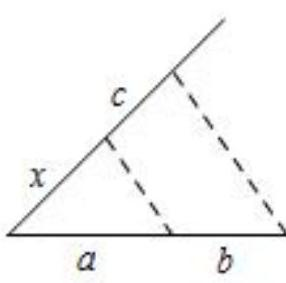
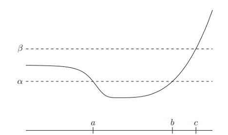

# AVP1776 — Single visual target

MV-MATH:505_1 / MathVista:723 · different type · Mathematical roles of symbols

## Shared or similar visual information

The lowercase letter a.

## Evidence locations

- Left image: a at the label under the left portion of the triangle base.
- Right image: a at the label under the first marked position on the horizontal axis.

## Mathematical meanings

Left image: a gives an unknown length (the label under the left portion of the triangle base). Right image: a denotes a specific value on the horizontal input axis (the label under the first marked position on the horizontal axis).

## Same mathematical meanings

no

## Rationales

On the left, a represents an unknown length (the label under the left portion of the triangle base). On the right, a denotes a specific value on the horizontal input axis (the label under the first marked position on the horizontal axis).

Only the selected target is annotated. AI visual-review draft; not independently double-annotated by humans.
