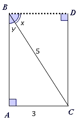
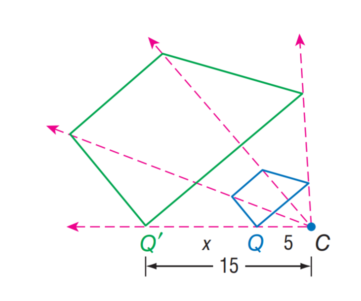

# AVP1777 — Single visual target

MathVerse:349 / MathVista:206 · same type · Mathematical roles of symbols

## Shared or similar visual information

The lowercase letter x.

## Evidence locations

- Left image: x at the wedge between dotted BD and diagonal BC.
- Right image: x at the label beneath the segment from Q′ to Q.

## Mathematical meanings

Left image: x gives an unknown angle measure (the wedge between dotted BD and diagonal BC). Right image: x gives an unknown length (the label beneath the segment from Q′ to Q).

## Same mathematical meanings

no

## Rationales

On the left, x represents an unknown angle measure (the wedge between dotted BD and diagonal BC). On the right, x represents an unknown length (the label beneath the segment from Q′ to Q).

Only the selected target is annotated. AI visual-review draft; not independently double-annotated by humans.
