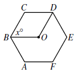
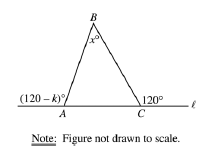

# AVP1780 — Single visual target

MathVista:280 / MathVista:434 · same type · Mathematical roles of symbols

## Shared or similar visual information

The lowercase letter x.

## Evidence locations

- Left image: x at the x° label between BC and BO.
- Right image: x at the x° label inside the top angle at B.

## Mathematical meanings

Left image: x gives an unknown angle measure (the x° label between BC and BO). Right image: x gives an unknown angle measure (the x° label inside the top angle at B).

## Same mathematical meanings

yes

## Rationales

In both images, x represents an unknown angle measure. The relevant locations are the x° label between BC and BO on the left and the x° label inside the top angle at B on the right.

Only the selected target is annotated. AI visual-review draft; not independently double-annotated by humans.
