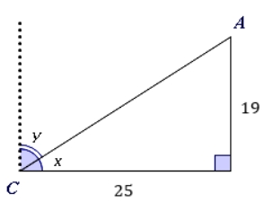
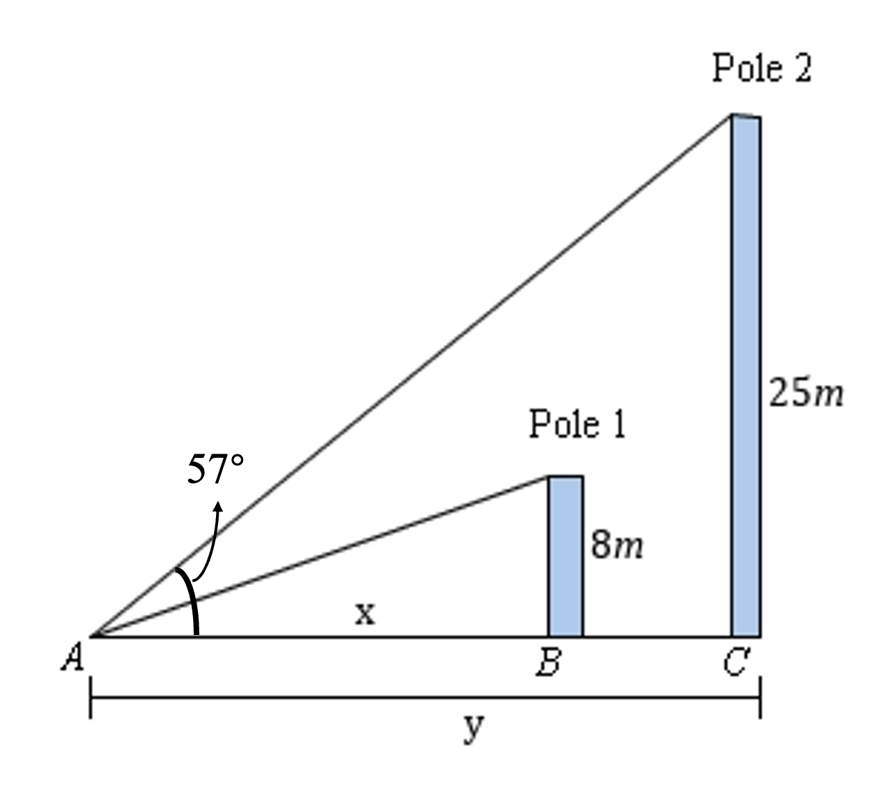

# AVP1783 — Single visual target

MathVerse:346 / MathVerse:351 · same type · Mathematical roles of symbols

## Shared or similar visual information

The lowercase letter x.

## Evidence locations

- Left image: x at the wedge between the base and slanted side at C.
- Right image: x at the label along the horizontal distance AB to the first pole.

## Mathematical meanings

Left image: x gives an unknown angle measure (the wedge between the base and slanted side at C). Right image: x gives an unknown length (the label along the horizontal distance AB to the first pole).

## Same mathematical meanings

no

## Rationales

On the left, x represents an unknown angle measure (the wedge between the base and slanted side at C). On the right, x represents an unknown length (the label along the horizontal distance AB to the first pole).

Only the selected target is annotated. AI visual-review draft; not independently double-annotated by humans.
