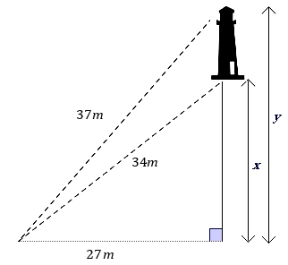
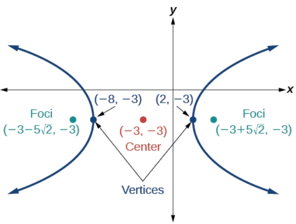

# AVP1794 — Single visual target

MathVerse:366 / MathVerse:438 · same type · Mathematical roles of symbols

## Shared or similar visual information

The lowercase letter y.

## Evidence locations

- Left image: y at the label beside the longest vertical dimension arrow at the lighthouse.
- Right image: y at the top of the vertical axis on the hyperbola diagram.

## Mathematical meanings

Left image: y gives an unknown length (the label beside the longest vertical dimension arrow at the lighthouse). Right image: y names the vertical coordinate axis (the top of the vertical axis on the hyperbola diagram).

## Same mathematical meanings

no

## Rationales

On the left, y represents an unknown length (the label beside the longest vertical dimension arrow at the lighthouse). On the right, y names the vertical coordinate axis (the top of the vertical axis on the hyperbola diagram).

Only the selected target is annotated. AI visual-review draft; not independently double-annotated by humans.
