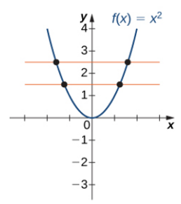
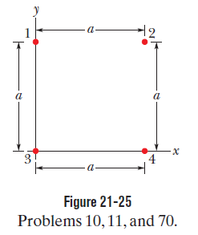

# AVP1795 — Single visual target

MathVista:137 / MathVista:294 · different type · Mathematical roles of symbols

## Shared or similar visual information

The lowercase letter y.

## Evidence locations

- Left image: y at the top arrow of the axis along the parabola’s symmetry line.
- Right image: y at the upper end of the vertical axis passing through points 1 and 3.

## Mathematical meanings

Left image: y names the vertical coordinate axis (the top arrow of the axis along the parabola’s symmetry line). Right image: y names the vertical coordinate axis (the upper end of the vertical axis passing through points 1 and 3).

## Same mathematical meanings

yes

## Rationales

In both images, y names the vertical coordinate axis. The relevant locations are the top arrow of the axis along the parabola’s symmetry line on the left and the upper end of the vertical axis passing through points 1 and 3 on the right.

Only the selected target is annotated. AI visual-review draft; not independently double-annotated by humans.
