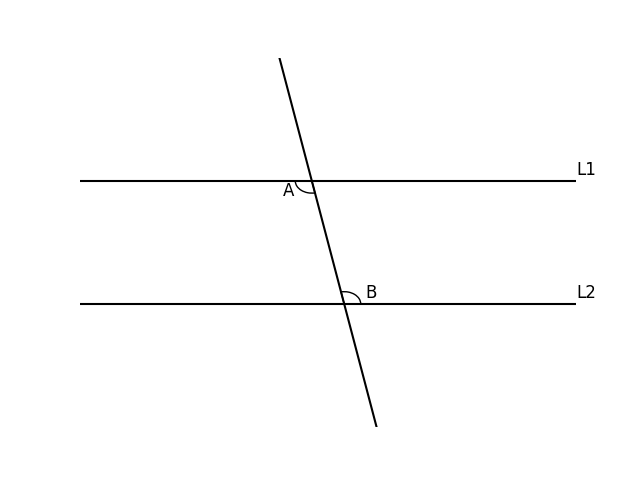
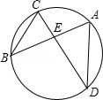

# AVP1803 — Single visual target

DynaMath:182 / MathVista:30 · same type · Mathematical roles of symbols

## Shared or similar visual information

The uppercase letter B.

## Evidence locations

- Left image: B at the arc above the lower horizontal line.
- Right image: B at the left-hand point on the circle.

## Mathematical meanings

Left image: B identifies the marked angle (the arc above the lower horizontal line). Right image: B names a specific point in the diagram (the left-hand point on the circle).

## Same mathematical meanings

no

## Rationales

On the left, B identifies the marked angle (the arc above the lower horizontal line). On the right, B names a specific point in the diagram (the left-hand point on the circle).

Only the selected target is annotated. AI visual-review draft; not independently double-annotated by humans.
