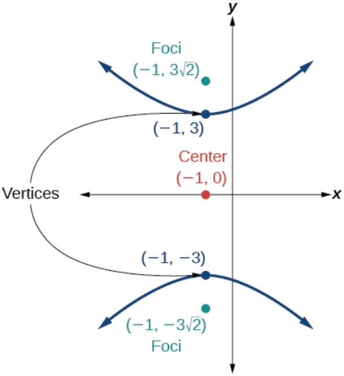
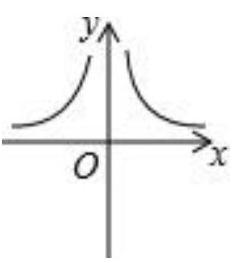

# AVP1804 — Single visual target

MathVerse:437 / MV-MATH:996_1 · different type · Mathematical roles of symbols

## Shared or similar visual information

The lowercase letter x.

## Evidence locations

- Left image: x at the right arrow of the axis passing through the hyperbola center.
- Right image: x at the right arrow of the horizontal axis beside the two branches.

## Mathematical meanings

Left image: x names the horizontal coordinate axis (the right arrow of the axis passing through the hyperbola center). Right image: x names the horizontal coordinate axis (the right arrow of the horizontal axis beside the two branches).

## Same mathematical meanings

yes

## Rationales

In both images, x names the horizontal coordinate axis. The relevant locations are the right arrow of the axis passing through the hyperbola center on the left and the right arrow of the horizontal axis beside the two branches on the right.

Only the selected target is annotated. AI visual-review draft; not independently double-annotated by humans.
