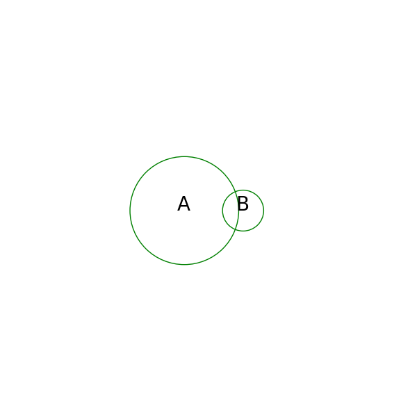
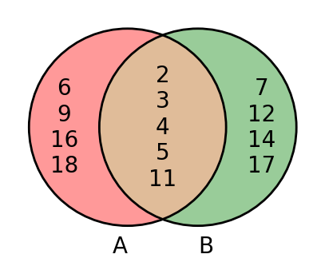

# AVP1807 — Single visual target

DynaMath:121 / DynaMath:470 · same type · Mathematical roles of symbols

## Shared or similar visual information

The uppercase letter A.

## Evidence locations

- Left image: A at the label inside the larger green circle.
- Right image: A at the label under the red circle containing 6 and 9 in its exclusive region.

## Mathematical meanings

Left image: A names the set represented by the circle (the label inside the larger green circle). Right image: A names the set represented by the circle (the label under the red circle containing 6 and 9 in its exclusive region).

## Same mathematical meanings

yes

## Rationales

In both images, A names the set represented by the circle. The relevant locations are the label inside the larger green circle on the left and the label under the red circle containing 6 and 9 in its exclusive region on the right.

Only the selected target is annotated. AI visual-review draft; not independently double-annotated by humans.
