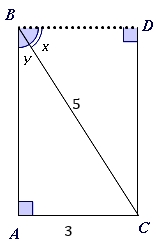
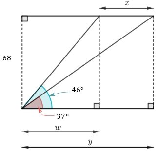

# AVP1810 — Single visual target

MathVerse:349 / MathVerse:358 · same type · Mathematical roles of symbols

## Shared or similar visual information

The lowercase letter y.

## Evidence locations

- Left image: y at the wedge between BA and BC.
- Right image: y at the label on the bottom arrow spanning the full width.

## Mathematical meanings

Left image: y gives an unknown angle measure (the wedge between BA and BC). Right image: y gives an unknown length (the label on the bottom arrow spanning the full width).

## Same mathematical meanings

no

## Rationales

On the left, y represents an unknown angle measure (the wedge between BA and BC). On the right, y represents an unknown length (the label on the bottom arrow spanning the full width).

Only the selected target is annotated. AI visual-review draft; not independently double-annotated by humans.
