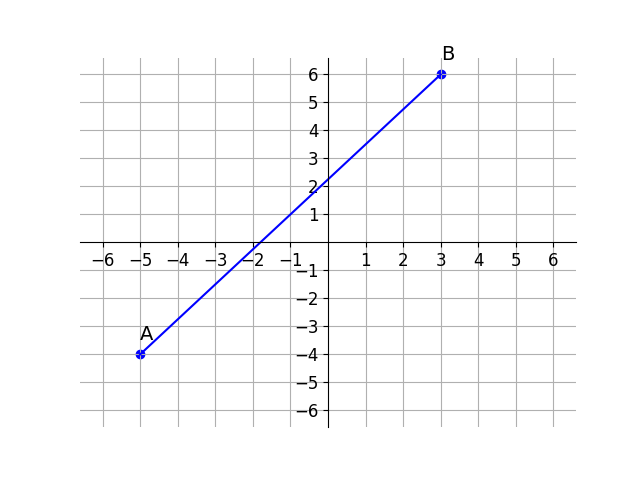
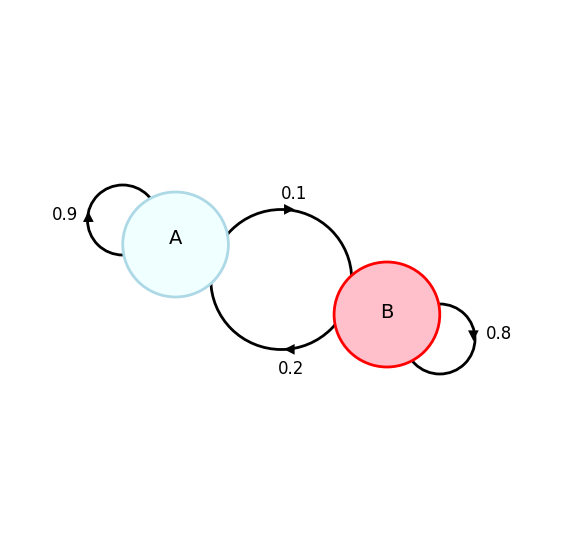

# AVP1812 — Single visual target

DynaMath:135 / DynaMath:72 · different type · Mathematical roles of symbols

## Shared or similar visual information

The uppercase letter A.

## Evidence locations

- Left image: A at the lower-left endpoint of the blue segment on the grid.
- Right image: A at the label inside the blue node with a loop.

## Mathematical meanings

Left image: A names a specific point in the diagram (the lower-left endpoint of the blue segment on the grid). Right image: A names a state in the transition diagram (the label inside the blue node with a loop).

## Same mathematical meanings

no

## Rationales

On the left, A names a specific point in the diagram (the lower-left endpoint of the blue segment on the grid). On the right, A names a state in the transition diagram (the label inside the blue node with a loop).

Only the selected target is annotated. AI visual-review draft; not independently double-annotated by humans.
