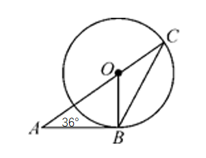
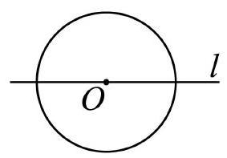

# AVP1813 — Single visual target

MathVerse:4 / MV-MATH:219_1 · same type · Mathematical roles of symbols

## Shared or similar visual information

The uppercase letter O.

## Evidence locations

- Left image: O at the center dot along AC.
- Right image: O at the dot on the line through the middle of the circle.

## Mathematical meanings

Left image: O names the center of the circle (the center dot along AC). Right image: O names the center of the circle (the dot on the line through the middle of the circle).

## Same mathematical meanings

yes

## Rationales

In both images, O names the center of the circle. The relevant locations are the center dot along AC on the left and the dot on the line through the middle of the circle on the right.

Only the selected target is annotated. AI visual-review draft; not independently double-annotated by humans.
