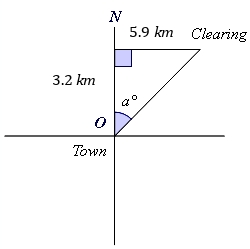
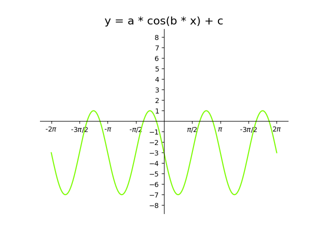

# AVP1815 — Single visual target

MathVerse:343 / DynaMath:346 · different type · Mathematical roles of symbols

## Shared or similar visual information

The lowercase letter a.

## Evidence locations

- Left image: a at the a° label on the wedge at O.
- Right image: a at the factor before cos in the formula above the graph.

## Mathematical meanings

Left image: a gives an unknown angle measure (the a° label on the wedge at O). Right image: a scales the trigonometric output and gives the amplitude through its absolute value (the factor before cos in the formula above the graph).

## Same mathematical meanings

no

## Rationales

On the left, a represents an unknown angle measure (the a° label on the wedge at O). On the right, a scales the trigonometric output and gives the amplitude through its absolute value (the factor before cos in the formula above the graph).

Only the selected target is annotated. AI visual-review draft; not independently double-annotated by humans.
