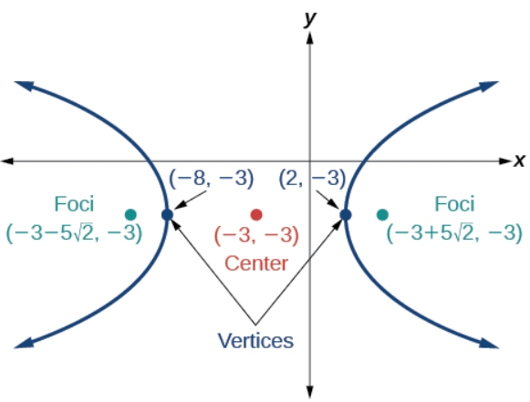
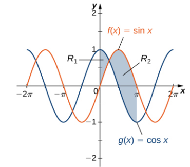

# AVP1816 — Single visual target

MathVerse:438 / MathVista:287 · different type · Mathematical roles of symbols

## Shared or similar visual information

The lowercase letter y.

## Evidence locations

- Left image: y at the top of the vertical axis on the hyperbola diagram.
- Right image: y at the upper arrow above the trigonometric curves.

## Mathematical meanings

Left image: y names the vertical coordinate axis (the top of the vertical axis on the hyperbola diagram). Right image: y names the vertical coordinate axis (the upper arrow above the trigonometric curves).

## Same mathematical meanings

yes

## Rationales

In both images, y names the vertical coordinate axis. The relevant locations are the top of the vertical axis on the hyperbola diagram on the left and the upper arrow above the trigonometric curves on the right.

Only the selected target is annotated. AI visual-review draft; not independently double-annotated by humans.
