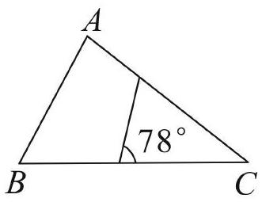
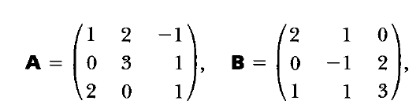

# AVP1832 — Single visual target

MV-MATH:526_1 / MathVista:577 · different type · Mathematical roles of symbols

## Shared or similar visual information

The uppercase letter A.

## Evidence locations

- Left image: A at the upper vertex of the triangle with the 78° interior construction.
- Right image: A at the label before the first parenthesized matrix.

## Mathematical meanings

Left image: A names a specific point in the diagram (the upper vertex of the triangle with the 78° interior construction). Right image: A names the matrix printed after the equals sign (the label before the first parenthesized matrix).

## Same mathematical meanings

no

## Rationales

On the left, A names a specific point in the diagram (the upper vertex of the triangle with the 78° interior construction). On the right, A names the matrix printed after the equals sign (the label before the first parenthesized matrix).

Only the selected target is annotated. AI visual-review draft; not independently double-annotated by humans.
