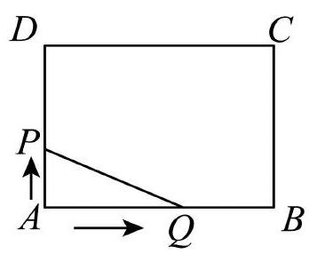
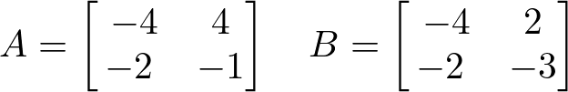

# AVP1835 — Single visual target

MV-MATH:635_1 / DynaMath:475 · different type · Mathematical roles of symbols

## Shared or similar visual information

The uppercase letter A.

## Evidence locations

- Left image: A at the lower-left corner of the rectangle.
- Right image: A at the label before the first bracketed matrix.

## Mathematical meanings

Left image: A names a specific point in the diagram (the lower-left corner of the rectangle). Right image: A names the matrix printed after the equals sign (the label before the first bracketed matrix).

## Same mathematical meanings

no

## Rationales

On the left, A names a specific point in the diagram (the lower-left corner of the rectangle). On the right, A names the matrix printed after the equals sign (the label before the first bracketed matrix).

Only the selected target is annotated. AI visual-review draft; not independently double-annotated by humans.
