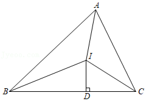
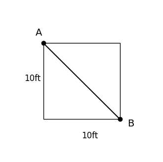

# AVP1836 — Single visual target

DynaMath:13 / DynaMath:80 · same type · Mathematical roles of symbols

## Shared or similar visual information

The uppercase letter A.

## Evidence locations

- Left image: A at the apex above base BC.
- Right image: A at the black point at the upper-left corner of the square.

## Mathematical meanings

Left image: A names a specific point in the diagram (the apex above base BC). Right image: A names a specific point in the diagram (the black point at the upper-left corner of the square).

## Same mathematical meanings

yes

## Rationales

In both images, A names a specific point in the diagram. The relevant locations are the apex above base BC on the left and the black point at the upper-left corner of the square on the right.

Only the selected target is annotated. AI visual-review draft; not independently double-annotated by humans.
