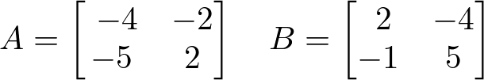
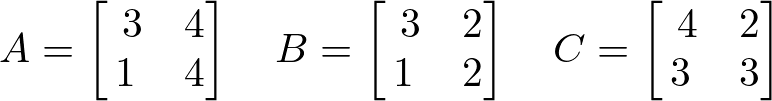

# AVP1838 — Single visual target

DynaMath:488 / DynaMath:478 · same type · Mathematical roles of symbols

## Shared or similar visual information

The uppercase letter B.

## Evidence locations

- Left image: B at the letter before the right bracketed array.
- Right image: B at the letter before the central bracketed array.

## Mathematical meanings

Left image: B names the matrix printed after the equals sign (the letter before the right bracketed array). Right image: B names the matrix printed after the equals sign (the letter before the central bracketed array).

## Same mathematical meanings

yes

## Rationales

In both images, B names the matrix printed after the equals sign. The relevant locations are the letter before the right bracketed array on the left and the letter before the central bracketed array on the right.

Only the selected target is annotated. AI visual-review draft; not independently double-annotated by humans.
