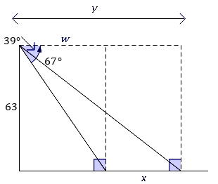
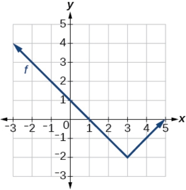

# AVP1841 — Single visual target

MathVerse:359 / MathVerse:493 · different type · Mathematical roles of symbols

## Shared or similar visual information

The lowercase letter x.

## Evidence locations

- Left image: x at the label under the span between the two vertical projections.
- Right image: x at the right tip of the horizontal axis beside the V-shaped graph.

## Mathematical meanings

Left image: x gives an unknown length (the label under the span between the two vertical projections). Right image: x names the horizontal coordinate axis (the right tip of the horizontal axis beside the V-shaped graph).

## Same mathematical meanings

no

## Rationales

On the left, x represents an unknown length (the label under the span between the two vertical projections). On the right, x names the horizontal coordinate axis (the right tip of the horizontal axis beside the V-shaped graph).

Only the selected target is annotated. AI visual-review draft; not independently double-annotated by humans.
