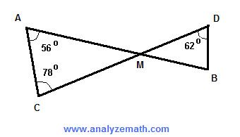
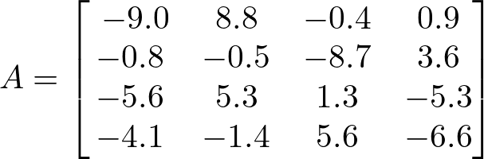

# AVP1845 — Single visual target

MathVista:630 / DynaMath:477 · different type · Mathematical roles of symbols

## Shared or similar visual information

The uppercase letter A.

## Evidence locations

- Left image: A at the upper-left vertex of the crossing triangles.
- Right image: A at the label before the 4 × 4 decimal matrix.

## Mathematical meanings

Left image: A names a specific point in the diagram (the upper-left vertex of the crossing triangles). Right image: A names the matrix printed after the equals sign (the label before the 4 × 4 decimal matrix).

## Same mathematical meanings

no

## Rationales

On the left, A names a specific point in the diagram (the upper-left vertex of the crossing triangles). On the right, A names the matrix printed after the equals sign (the label before the 4 × 4 decimal matrix).

Only the selected target is annotated. AI visual-review draft; not independently double-annotated by humans.
