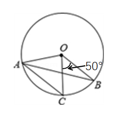
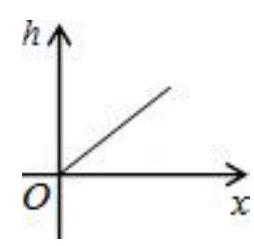

# AVP1850 — Single visual target

MathVerse:16 / MV-MATH:1063_1 · different type · Mathematical roles of symbols

## Shared or similar visual information

The uppercase letter O.

## Evidence locations

- Left image: O at the center point where the three radii meet.
- Right image: O at the label where the x and h axes meet.

## Mathematical meanings

Left image: O names the center of the circle (the center point where the three radii meet). Right image: O names the origin of the coordinate axes (the label where the x and h axes meet).

## Same mathematical meanings

no

## Rationales

On the left, O names the center of the circle (the center point where the three radii meet). On the right, O names the origin of the coordinate axes (the label where the x and h axes meet).

Only the selected target is annotated. AI visual-review draft; not independently double-annotated by humans.
