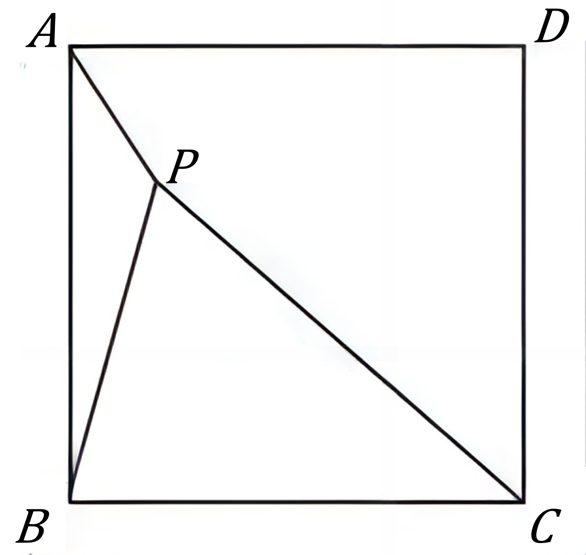
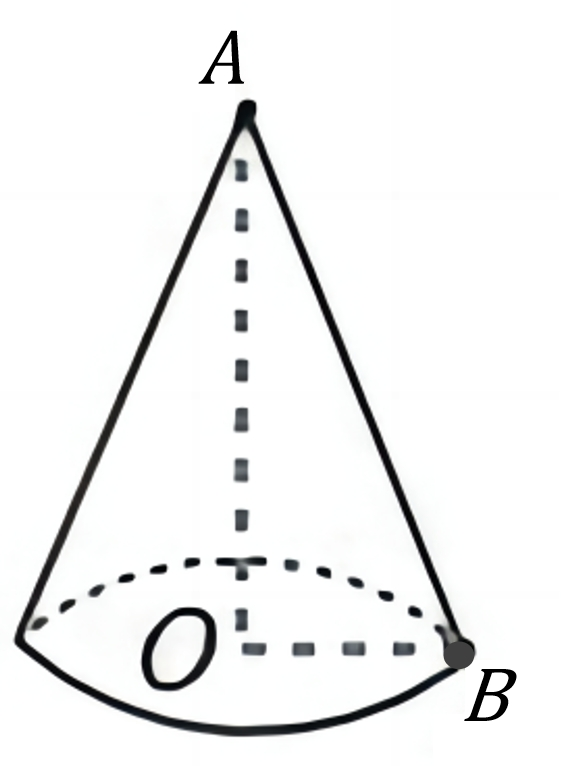

# AVP1851 — Single visual target

DynaMath:145 / DynaMath:8 · different type · Mathematical roles of symbols

## Shared or similar visual information

The uppercase letter B.

## Evidence locations

- Left image: B at the lower-left vertex of the square.
- Right image: B at the marked point on the right of the base rim.

## Mathematical meanings

Left image: B names a specific point in the diagram (the lower-left vertex of the square). Right image: B names a specific point in the diagram (the marked point on the right of the base rim).

## Same mathematical meanings

yes

## Rationales

In both images, B names a specific point in the diagram. The relevant locations are the lower-left vertex of the square on the left and the marked point on the right of the base rim on the right.

Only the selected target is annotated. AI visual-review draft; not independently double-annotated by humans.
