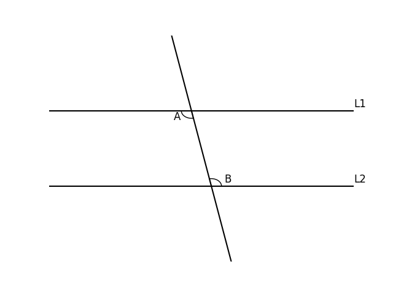
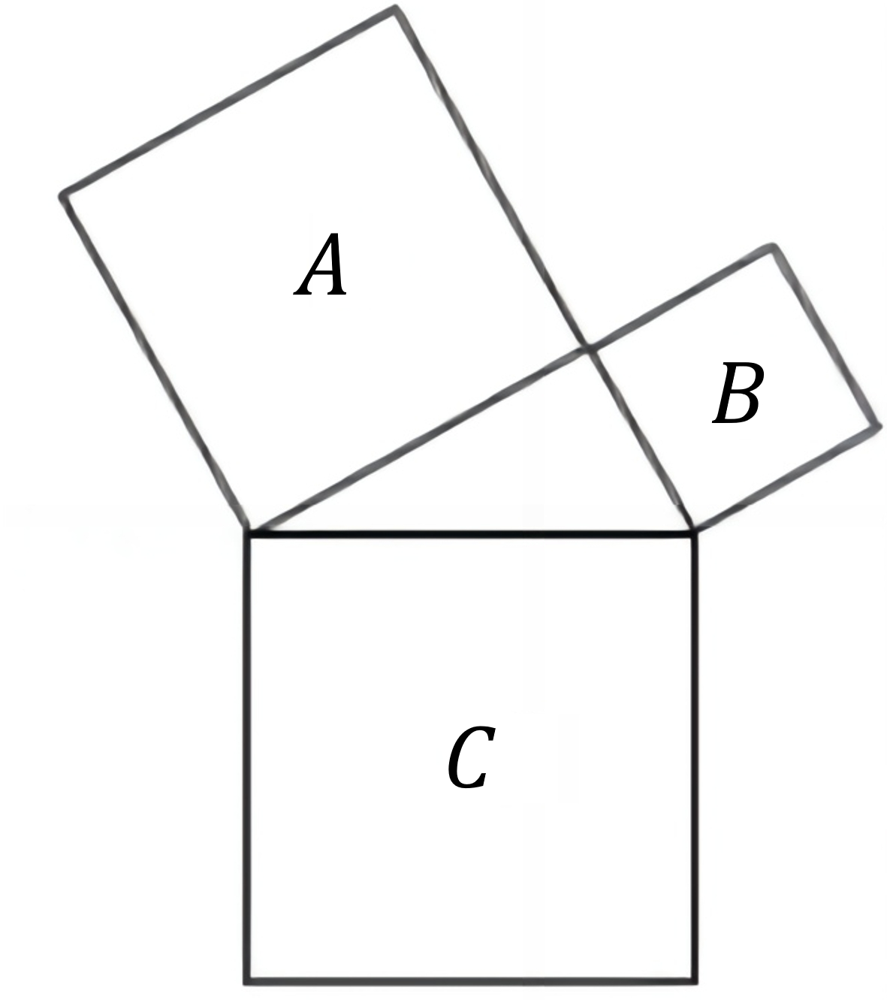

# AVP1857 — Single visual target

DynaMath:182 / DynaMath:85 · same type · Mathematical roles of symbols

## Shared or similar visual information

The uppercase letter B.

## Evidence locations

- Left image: B at the arc above the lower horizontal line.
- Right image: B at the label inside the smaller tilted square.

## Mathematical meanings

Left image: B identifies the marked angle (the arc above the lower horizontal line). Right image: B identifies a square region (the label inside the smaller tilted square).

## Same mathematical meanings

no

## Rationales

On the left, B identifies the marked angle (the arc above the lower horizontal line). On the right, B identifies a square region (the label inside the smaller tilted square).

Only the selected target is annotated. AI visual-review draft; not independently double-annotated by humans.
