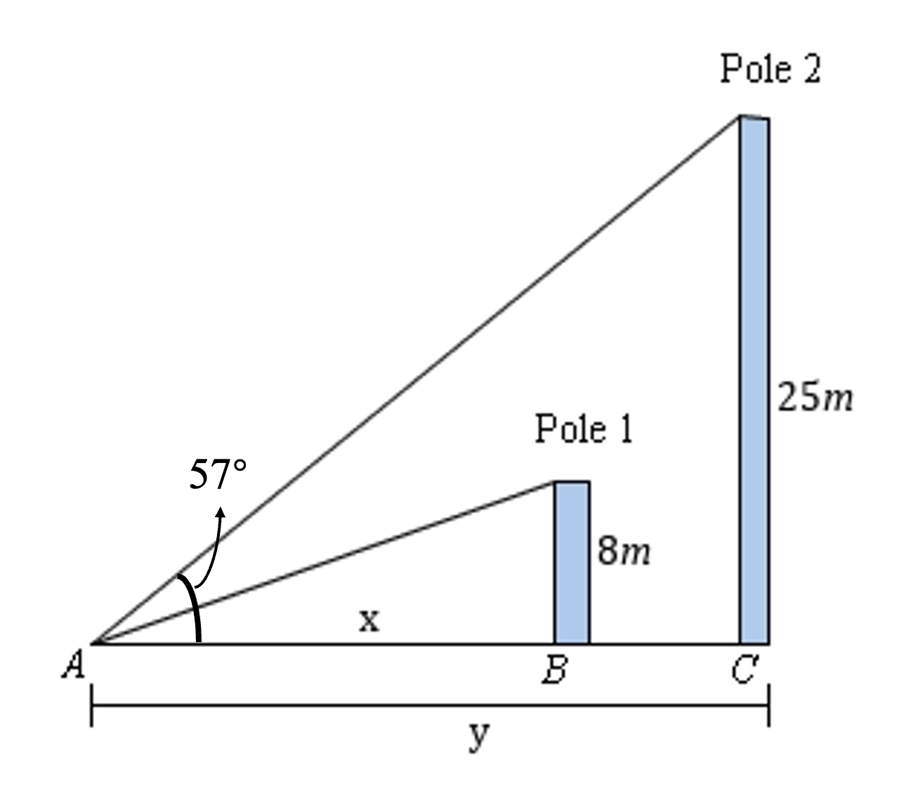

# AVP1877 — Single visual target

MathVerse:351 / DynaMath:64 · different type · Mathematical roles of symbols

## Shared or similar visual information

The lowercase letter y.

## Evidence locations

- Left image: y at the label beside the lower dimension line from A to C.
- Right image: y at the left-hand side of y = −(x + 5)(x − 5).

## Mathematical meanings

Left image: y gives an unknown length (the label beside the lower dimension line from A to C). Right image: y is the dependent output variable in the formula defining the graph (the left-hand side of y = −(x + 5)(x − 5)).

## Same mathematical meanings

no

## Rationales

On the left, y represents an unknown length (the label beside the lower dimension line from A to C). On the right, y is the dependent output variable in the formula defining the graph (the left-hand side of y = −(x + 5)(x − 5)).

Only the selected target is annotated. AI visual-review draft; not independently double-annotated by humans.
