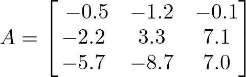
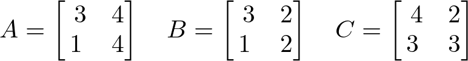

# AVP1878 — Single visual target

DynaMath:474 / DynaMath:478 · same type · Mathematical roles of symbols

## Shared or similar visual information

The uppercase letter A.

## Evidence locations

- Left image: A at the label before the three-row decimal matrix.
- Right image: A at the label before the leftmost of three matrices.

## Mathematical meanings

Left image: A names the matrix printed after the equals sign (the label before the three-row decimal matrix). Right image: A names the matrix printed after the equals sign (the label before the leftmost of three matrices).

## Same mathematical meanings

yes

## Rationales

In both images, A names the matrix printed after the equals sign. The relevant locations are the label before the three-row decimal matrix on the left and the label before the leftmost of three matrices on the right.

Only the selected target is annotated. AI visual-review draft; not independently double-annotated by humans.
