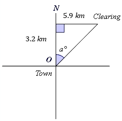
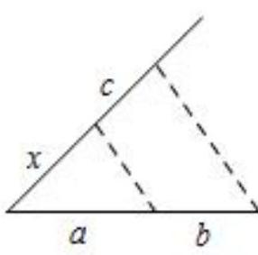

# AVP1879 — Single visual target

MathVerse:343 / MV-MATH:505_1 · same type · Mathematical roles of symbols

## Shared or similar visual information

The lowercase letter a.

## Evidence locations

- Left image: a at the a° label on the wedge at O.
- Right image: a at the label under the left portion of the triangle base.

## Mathematical meanings

Left image: a gives an unknown angle measure (the a° label on the wedge at O). Right image: a gives an unknown length (the label under the left portion of the triangle base).

## Same mathematical meanings

no

## Rationales

On the left, a represents an unknown angle measure (the a° label on the wedge at O). On the right, a represents an unknown length (the label under the left portion of the triangle base).

Only the selected target is annotated. AI visual-review draft; not independently double-annotated by humans.
