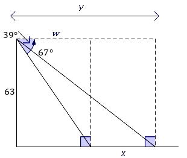
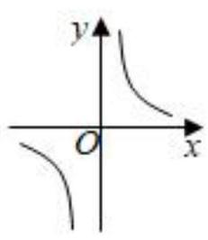

# AVP1881 — Single visual target

MathVerse:359 / MV-MATH:1080_1 · different type · Mathematical roles of symbols

## Shared or similar visual information

The lowercase letter y.

## Evidence locations

- Left image: y at the label beside the upper arrow for the full horizontal span.
- Right image: y at the upper arrow between the two function branches.

## Mathematical meanings

Left image: y gives an unknown length (the label beside the upper arrow for the full horizontal span). Right image: y names the vertical coordinate axis (the upper arrow between the two function branches).

## Same mathematical meanings

no

## Rationales

On the left, y represents an unknown length (the label beside the upper arrow for the full horizontal span). On the right, y names the vertical coordinate axis (the upper arrow between the two function branches).

Only the selected target is annotated. AI visual-review draft; not independently double-annotated by humans.
