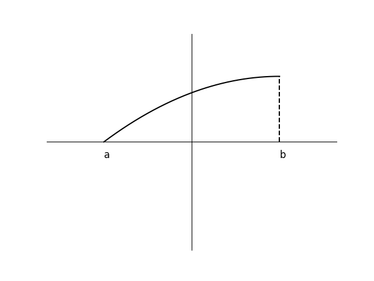
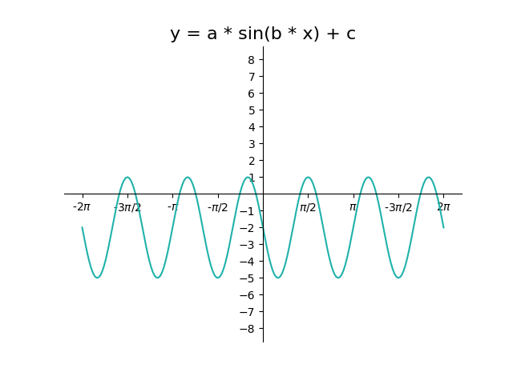

# AVP1883 — Single visual target

DynaMath:204 / DynaMath:345 · same type · Mathematical roles of symbols

## Shared or similar visual information

The lowercase letter a.

## Evidence locations

- Left image: a at the label beneath the left endpoint of the curve.
- Right image: a at the factor before sin in the formula above the graph.

## Mathematical meanings

Left image: a denotes a specific value on the horizontal input axis (the label beneath the left endpoint of the curve). Right image: a scales the trigonometric output and gives the amplitude through its absolute value (the factor before sin in the formula above the graph).

## Same mathematical meanings

no

## Rationales

On the left, a denotes a specific value on the horizontal input axis (the label beneath the left endpoint of the curve). On the right, a scales the trigonometric output and gives the amplitude through its absolute value (the factor before sin in the formula above the graph).

Only the selected target is annotated. AI visual-review draft; not independently double-annotated by humans.
