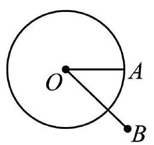
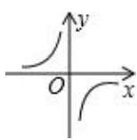

# AVP1885 — Single visual target

MV-MATH:210_1 / MV-MATH:963_1 · different type · Mathematical roles of symbols

## Shared or similar visual information

The uppercase letter O.

## Evidence locations

- Left image: O at the dot at the common endpoint of the two rays.
- Right image: O at the label at the crossing of the graph axes.

## Mathematical meanings

Left image: O names the center of the circle (the dot at the common endpoint of the two rays). Right image: O names the origin of the coordinate axes (the label at the crossing of the graph axes).

## Same mathematical meanings

no

## Rationales

On the left, O names the center of the circle (the dot at the common endpoint of the two rays). On the right, O names the origin of the coordinate axes (the label at the crossing of the graph axes).

Only the selected target is annotated. AI visual-review draft; not independently double-annotated by humans.
